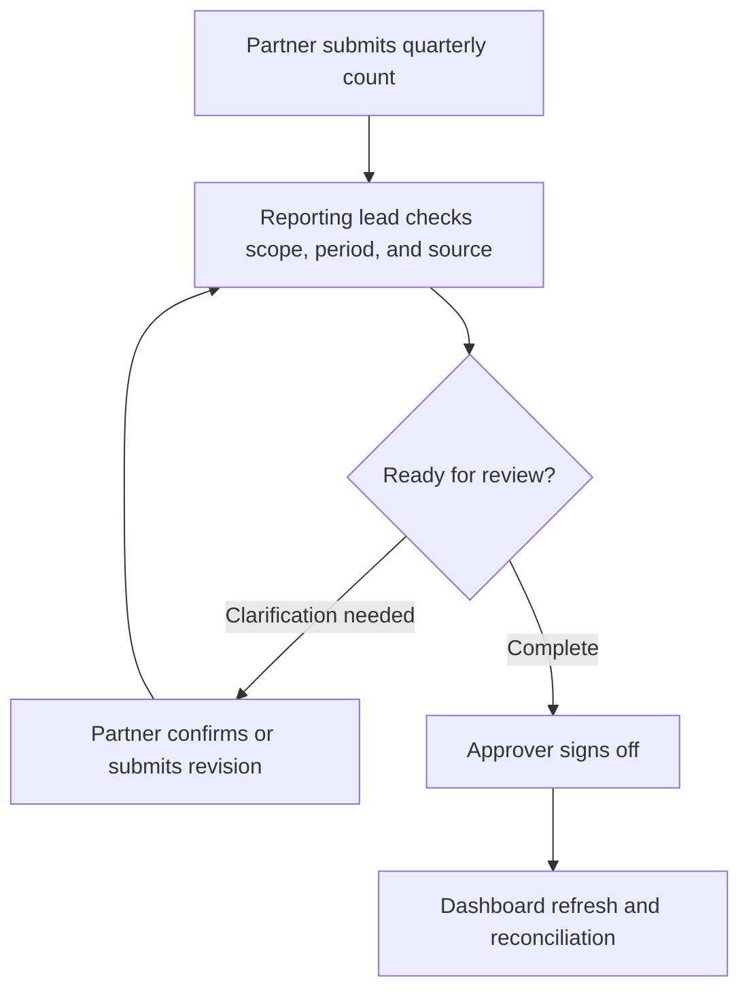

# Designing a reporting workflow for a multi-partner program

I manage performance monitoring and reporting for a family economic mobility portfolio. This work sample shows how I turn a recurring reporting problem into a metric definition, review workflow, and leadership brief. The workflow is a simplified reconstruction. All organizations, records, figures, and decisions below are fictional.

## The problem

Program partners report quarterly. One partner submits a count for the quarter, another submits a year-to-date count, and another revises a figure after review. Leadership needs a credible progress update and a clear account of which results still need follow-up.

## Metric definition

| Field | Rule |
| --- | --- |
| Metric | Families completing at least one coaching session |
| Unit and scope | Distinct families within each partner’s funded program |
| Reporting window | Quarter, based on the session date |
| Deduplication | Each family counts once per partner per quarter. A family can appear under multiple partners or across quarters. |
| Approval | Use the latest approved revision for each partner and period. Keep the original submission and approval history. |
| Portfolio display | Sum approved partner-level counts and label them as such. Report coverage alongside the count. A portfolio-wide unique count requires approved cross-partner deduplication. |

## Workflow and ownership

The reporting lead retains submission and revision dates, the reason for changes, and the approval decision. At refresh, the dashboard owner compares published counts and coverage against the approved records. The reporting lead logs any post-release correction and records its impact on the published figure.

## Worked example

| Partner | Submission history | Treatment | Included count |
| --- | --- | --- | ---: |
| Harbor | Submitted 42 for the quarter. Confirmed a duplicate and revised to 41. Revision approved. | Use the approved revision and retain the original. | 41 |
| Maple | Submitted 127 year to date. Quarterly count pending. | Request a quarterly count using the same definition. | — |
| Orchard | Submitted zero for the quarter and confirmed no qualifying sessions. Approved. | Include the verified zero in reporting coverage. | 0 |
| Union | Submitted and received approval for 18 distinct families this quarter. | Include the approved count. | 18 |
| **Total** | **Three of four partners have approved quarterly counts.** | **Sum of partner-level counts.** | **59** |

Subtracting prior year-to-date unique counts from current year-to-date unique counts would miss families who participated in both windows. Maple needs to deduplicate at the quarter level and resubmit.

## Example leadership update

Three of four partners have approved results for the quarter. Together they reported 59 partner-level family counts. Families served by more than one partner may appear more than once. Maple’s result is pending because its submission covered the year to date. The reporting lead will request a quarter-specific count and flag any change to the total in the next release.

## Checks before rollout

| Test | Expected behavior |
| --- | --- |
| Missing count versus confirmed zero | A blank stays pending. An approved zero counts toward reporting coverage. |
| Revision awaiting approval | The published figure continues to use the prior approved version until the revision is approved and reconciled. |
| Duplicate submission | The approval view selects one current record per partner, metric, and period. |
| Two partners serve the same family | Report the sum as partner-level counts. Use a portfolio-wide unique total only when the necessary deduplication is available. |
| Annual executive summary | Request annual distinct counts. A sum of quarterly counts may include the same family more than once. |
